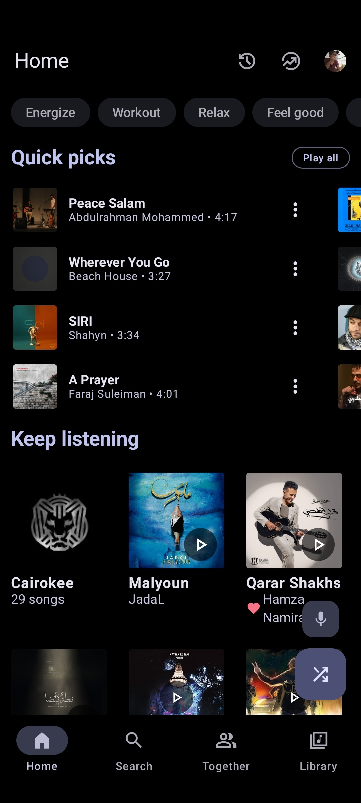
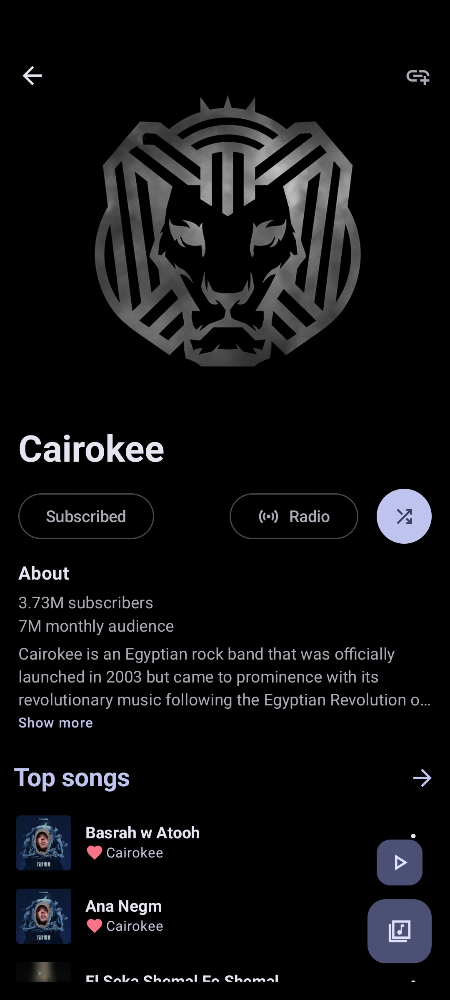
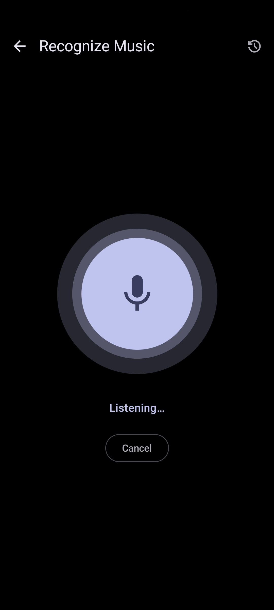
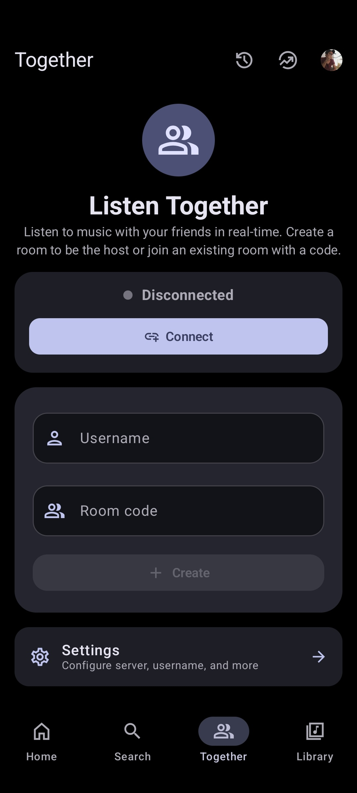
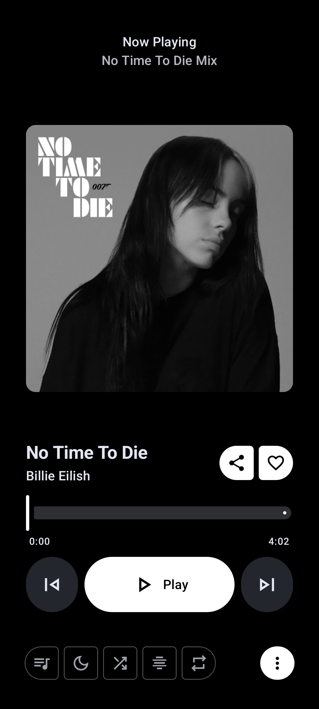
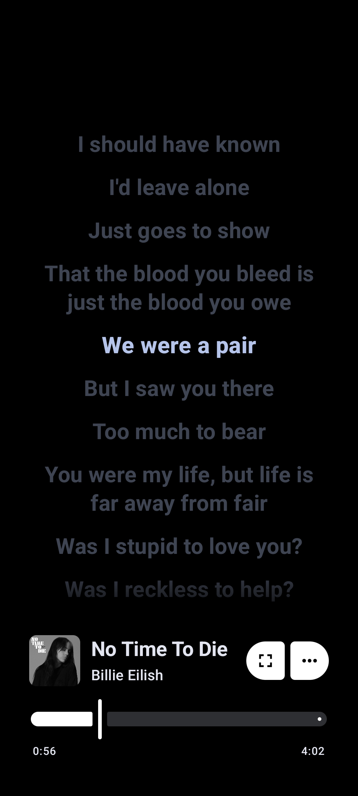
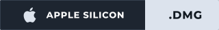

<div align="center">


<br/>
<br/>


# YuruTune

### Your cozy music space: a Material Design YouTube Music client for Android

<br/>

[](LICENSE)
[](https://github.com/MetrolistGroup/Metrolist)

<br/>

[**Download**](#download-now) · [**Features**](#features) · [**Translate**](#translations) · [**Support**](#support-the-project) · [**License**](#license)

</div>

> [!IMPORTANT]
> # Credits & Thanks
> **YuruTune is a lightweight rebrand of [Metrolist](https://github.com/MetrolistGroup/Metrolist)**, created by **[Mo Agamy](https://github.com/mostafaalagamy)** and the **[MetrolistGroup](https://github.com/MetrolistGroup)** contributors.  
> All the hard work behind the app, its features and its code belongs to them. Huge thanks to everyone who built Metrolist! 🙏  
> YuruTune is rebranded and maintained by **Nimzz** ([@NimzzAI](https://github.com/NimzzAI)).
>
> Original project: [GitHub](https://github.com/MetrolistGroup/Metrolist) · [Website](https://metrolist.cc) · [Discord](https://dsc.gg/metrolist) · [Telegram](https://t.me/metrolistapp)

> [!WARNING]
> <details>
>   <summary>The use of YuruTune to access YouTube Music may violate YouTube's Terms of Service.</summary>
>   <p>You use YuruTune at your own risk. You are solely responsible for any consequences. The contributors of YuruTune and Metrolist are not liable for damages, claims or actions against your account. We have received no reports of bans or restrictions for using Metrolist, but that does not guarantee your account's safety.</p>
> </details>
>
> YouTube Music is region-restricted. If the service is unavailable in your region, you need a [VPN or proxy in a supported region](https://one.one.one.one/) to use the app. [Changing your DNS](https://developers.cloudflare.com/1.1.1.1/setup/) can bypass some blocks.

<!---

DO NOT REMOVE THIS SECTION, I WANT TO ADD IT LATER!!!
---
<div align="center">

<h1><a id="screenshots"></a>Screenshots</h1>








</div>
-->

<div align="center">
<h1>Features</h1>
</div>

- YouTube Music playback with or without signing in
- Android 7+, iOS 17+, Windows 10+, macOS 15+ and Linux support
- Material 3 Expressive design
- Discord Rich Presence and scrobbling through Last.fm and ListenBrainz
- No ads
- Listen Together for shared playback online
- Casting to Google Cast, F-Cast and SONOS devices, and over DLNA (Android and desktop)
- Backup and playlist imports from 30+ clients and 6 services
- Music recognition through Shazam
- Lyrics with translation and romanization
- Translations in over 15 languages
- Video playback (Android and desktop)
- Content filters for AI-generated content, explicit-only playback and SFW-only playback
- Canvas from Apple Music, Spotify and YouTube Music
- Player, thumbnail, miniplayer and background styles
- Custom fonts and app icons

> [!TIP]
> <p>YuruTune works like Metrolist, so the <a href="https://metrolist.cc/#faq">Metrolist FAQ</a> answers most common questions.</p>

<br>

<div align="center">

<h1><a id="download-now"></a>Download now</h1>

<p>Get the Android APK from the <a href="../../releases">Releases</a> page of this repository, or build it yourself in a few taps:</p>

</div>

1. Open the **Actions** tab of this repository and choose **Build YuruTune APK**.
2. Tap **Run workflow**, then **Run workflow** again, and wait for the green check (about 15 minutes).
3. Open the finished run, scroll to **Artifacts**, download **YuruTune-APK**, unzip it and install the APK.

No keystore or secrets are needed: the workflow builds a debug-signed APK. The app checks for updates in the original Metrolist repository, so the in-app update check is turned off by default.

<div align="center">

<details>
<summary><b>Original Metrolist downloads (desktop, iOS and more)</b></summary>

<br/>

<p>These builds come from the original Metrolist project, not from YuruTune. Install Metrolist: <a href="docs/install/android.md">Android</a>, <a href="docs/install/ios.md">iOS</a>, <a href="docs/install/windows.md">Windows</a>, <a href="docs/install/macos.md">macOS</a> or <a href="docs/install/linux.md">Linux</a>.</p>

<table>
  <tr>
    <td align="center" valign="top" width="33%">
      <h2>Windows</h2>
      <p>Windows 10+ · pick your chip</p>
      <p><sub>x64 · installer and portable</sub></p>
      <p>
        <a href="https://github.com/MetrolistGroup/Metrolist/releases/latest">
          
        </a>
      </p>
      <p>
        <a href="https://github.com/MetrolistGroup/Metrolist/releases/latest/download/Metrolist-Desktop-windows.zip"></a>
      </p>
      <p><sub>ARM64 · portable only</sub></p>
      <p>
        <a href="https://github.com/MetrolistGroup/Metrolist/releases/latest"></a>
      </p>
    </td>
    <td align="center" valign="top" width="33%">
      <h2>macOS</h2>
      <p>macOS 15+ · pick your chip</p>
      <p>
        <a href="https://github.com/MetrolistGroup/Metrolist/releases/latest">
          
        </a>
      </p>
      <p>
        <a href="https://github.com/MetrolistGroup/Metrolist/releases/latest">
          
        </a>
      </p>
      <p><sub>Unsigned app, you need to trust it first</sub></p>
    </td>
    <td align="center" valign="top" width="33%">
      <h2>iOS</h2>
      <p>iPhone &amp; iPad · iOS 17+</p>
      <p>
        <a href="https://github.com/MetrolistGroup/Metrolist/releases/latest/download/Metrolist.ipa">
          
        </a>
      </p>
      <p><sub>AltStore, SideStore, TrollStore or Sideloadly</sub></p>
    </td>
  </tr>
  <tr>
    <td align="center" valign="top" width="33%">
      <h2>Android</h2>
      <p>Android 7+</p>
      <p>
        <a href="https://github.com/MetrolistGroup/Metrolist/releases/latest/download/Metrolist.apk">
          
        </a>
      </p>
    </td>
    <td align="center" valign="top" width="33%">
      <h2>Linux</h2>
      <p>glibc · pick your chip</p>
      <p><sub>x86_64 · AppImage or packages</sub></p>
      <p>
        <a href="https://github.com/MetrolistGroup/Metrolist/releases/latest"></a>
      </p>
      <p>
        <a href="https://aur.archlinux.org/packages/metrolist-desktop-bin"></a>
      </p>
      <p>
        <a href="docs/install/linux.md#nix"></a>
      </p>
      <p><sub>ARM64 · AppImage or Nix</sub></p>
      <p>
        <a href="https://github.com/MetrolistGroup/Metrolist/releases/latest"></a>
      </p>
      <p>
        <a href="docs/install/linux.md#nix"></a>
      </p>
    </td>
    <td align="center" valign="top" width="33%">
      <h2>Android stores</h2>
      <p>The app already has a built-in updater.</p>
      <p>
        <a href="https://apps.obtainium.imranr.dev/redirect?r=obtainium://add/https://github.com/MetrolistGroup/Metrolist/">
          
        </a>
      </p>
      <p>
        <a href="https://apt.izzysoft.de/fdroid/index/apk/com.metrolist.music">
          
        </a>
      </p>
      <p>
        <a href="https://www.openapk.net/metrolist/com.metrolist.music/">
          
        </a>
      </p>
    </td>
  </tr>
</table>

</details>

</div>

<br>

<div align="center">

<h1><a id="support-the-project"></a>Support the project</h1>

YuruTune is free and open-source and exists thanks to Metrolist. If you want to donate, please support the original developers:

<p>
  <a href="https://github.com/sponsors/nyxiereal">
    
  </a>
  <a href="https://www.buymeacoffee.com/mostafaalagamy">
    
  </a>
  <a href="https://github.com/sponsors/l6t9">
    
  </a>
  <a href="https://github.com/sponsors/adrielggmotion">
    
  </a>
</p>

<details>
  <summary>Donate Monero to Mostafa Alagamy</summary>
  <p>
    
  </p>

```text
44XjSELSWcgJTZiCKzjpCQWyXhokrH9RqH3rpp35FkSKi57T25hniHWHQNhLeXyFn3DDYqufmfRB1iEtENerZpJc7xJCcqt
```

</details>
</div>

<br>

<div align="center">

<h1>Special thanks</h1>

YuruTune is based on Metrolist and uses these projects and services.

<table>
  <thead>
    <tr>
      <th align="center">Project</th>
      <th align="center">Contribution</th>
    </tr>
  </thead>
  <tbody>
    <tr>
      <td align="center"><a href="https://github.com/MetrolistGroup/Metrolist">Metrolist</a></td>
      <td>The base project, by <a href="https://github.com/mostafaalagamy">Mo Agamy</a> and <a href="https://github.com/MetrolistGroup">MetrolistGroup</a></td>
    </tr>
    <tr>
      <td align="center"><a href="https://github.com/aleksey-saenko/MusicRecognizer">MusicRecognizer</a></td>
      <td>Music recognition through the Shazam API</td>
    </tr>
    <tr>
      <td align="center"><a href="https://github.com/MetrolistGroup/innertubex">InnerTubeX</a></td>
      <td>YouTube streaming engine, developed with help from <a href="https://github.com/ZemerTeam/">ZemerTeam</a></td>
    </tr>
    <tr>
      <td align="center">Lyprio</td>
      <td>Lyrics provider</td>
    </tr>
    <tr>
      <td align="center"><a href="https://github.com/MetrolistGroup/metroserver">metroserver</a></td>
      <td>Listen Together real-time synchronization backend</td>
    </tr>
  </tbody>
</table>
</div>

<br>

<div align="center">

<h1><a id="translations"></a>Translations</h1>

<p>YuruTune uses the translations of Metrolist, which are managed on Weblate. <a href="https://hosted.weblate.org/projects/Metrolist/">Contribute a translation to Metrolist</a>.</p>

<a href="https://hosted.weblate.org/projects/Metrolist/">
  
</a>
</div>

<br>

<div align="center">
<h1>Contributors</h1>
<p>YuruTune would not exist without the people who built Metrolist.</p>
<a href="https://github.com/MetrolistGroup/Metrolist/graphs/contributors">
  
</a>
</div>

<br>

<div align="center">

<h1><a id="license"></a>License</h1>

YuruTune is a modified version of [Metrolist](https://github.com/MetrolistGroup/Metrolist) and is distributed under the **[GNU General Public License v3.0](LICENSE)**, the same license as the original project.  
The original copyright and license notices are preserved. You may use, study, share and improve this software under the terms of the GPL-3.0.

</div>

<br>

> [!WARNING]
> <h2>Legal disclaimer</h2>
> <p>This project is not affiliated with, funded, authorized or endorsed by YouTube, Google LLC, MetroList MLS, Metrolist Group, or their affiliates and subsidiaries. YuruTune is an independent derivative of Metrolist and is not an official Metrolist release.</p>
>
> <p>All trademarks, service marks, and intellectual property rights referenced in this project belong to their respective owners.</p>

<br/>

<div align="center">

**YuruTune, rebranded by Nimzz**

**Based on Metrolist, developed by [Mo Agamy](https://github.com/mostafaalagamy) & [the Metrolist development team](https://github.com/MetrolistGroup)**

**This project stands with Palestine 🇵🇸**

</div>
